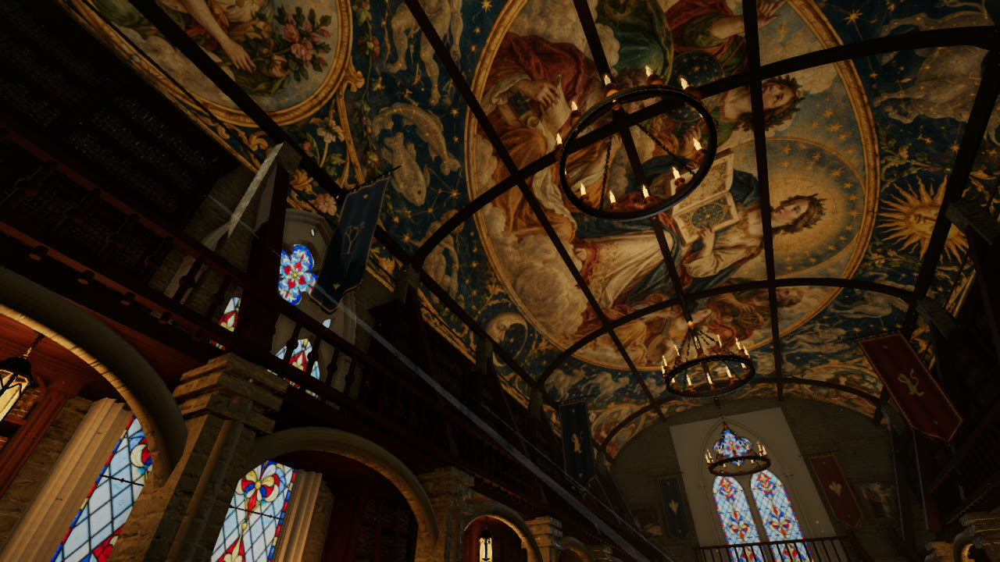

# Astra — The Great Library

An interactive 3D gothic library that runs in the browser: wooden galleries, stairs, stained glass, banners, chandeliers, tables and chairs, and thousands of individually removable books.

**Play it: https://swarogan.github.io/astra-library-3d/**

The scene is a procedural reconstruction inspired by a reference painting, not a photorealistic copy. Every book on the shelves is its own object with physics, a movable cover and 16 pages with text and illustrations. Furniture, scrolls, goblets, globes, hourglasses, ladders, candlesticks, lanterns, chandeliers and the statue can be moved too.

## Requirements

A desktop browser with WebGL2 and hardware acceleration enabled. Touch controls (virtual joystick and buttons) appear on phones and tablets; add `?touch=1` to the address to force them on a desktop browser.

## Controls

| Key | Action |
| --- | --- |
| WASD / arrow keys | Walk |
| Mouse | Look around |
| Shift | Move faster |
| Space | Jump; ascend while flying |
| F | Toggle hovering |
| Ctrl / C | Descend while flying |
| E / left click | Grab or release the object under the crosshair |
| Right click + mouse | Rotate the held item |
| Mouse wheel | Hold distance; page turning for an open book |
| O | Open / close the held book |
| [ / ] or PageUp / PageDown | Turn a page |
| T | Spin the globe or sphere |
| Q | Throw the held item |
| R | Return the held item to its place |
| H | Hide / show the interface |
| Esc | Release the mouse and open the menu |

The positions of moved objects are saved in your browser's `localStorage`. **Restore items** in the menu resets them.

## About this repository

This repository contains only the production build served by GitHub Pages. It is a static site with no server component.

## Credits

- Built with [Three.js](https://threejs.org/) (MIT), [cannon-es](https://github.com/pmndrs/cannon-es) (MIT) and [Vite](https://vitejs.dev/) (MIT).
- PBR textures from [Poly Haven](https://polyhaven.com/) (CC0): Wood Table 001, White Sandstone Bricks, Monastery Stone Floor.
- Book covers, manuscript illustrations, the ceiling fresco and the globe map are AI-generated artwork.
- Fonts: Cormorant Garamond and Manrope (SIL Open Font License), with system fallbacks when offline.
